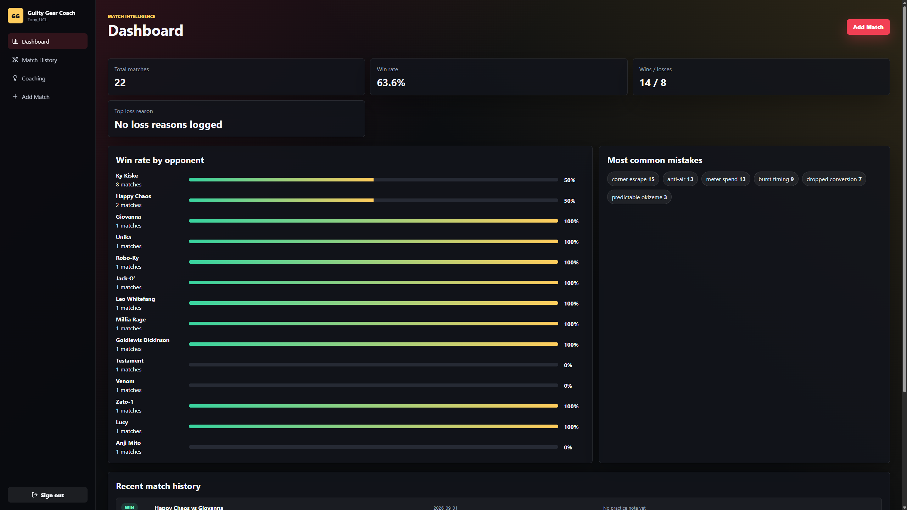
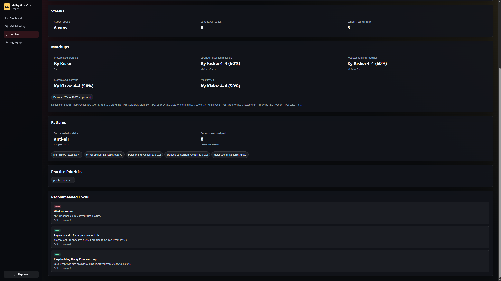
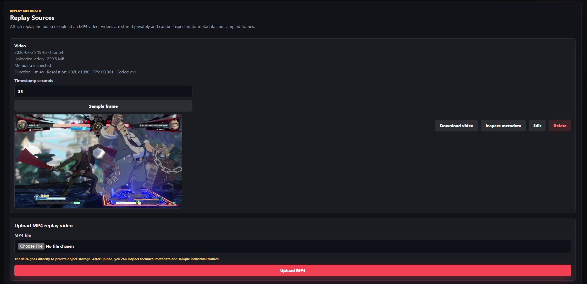
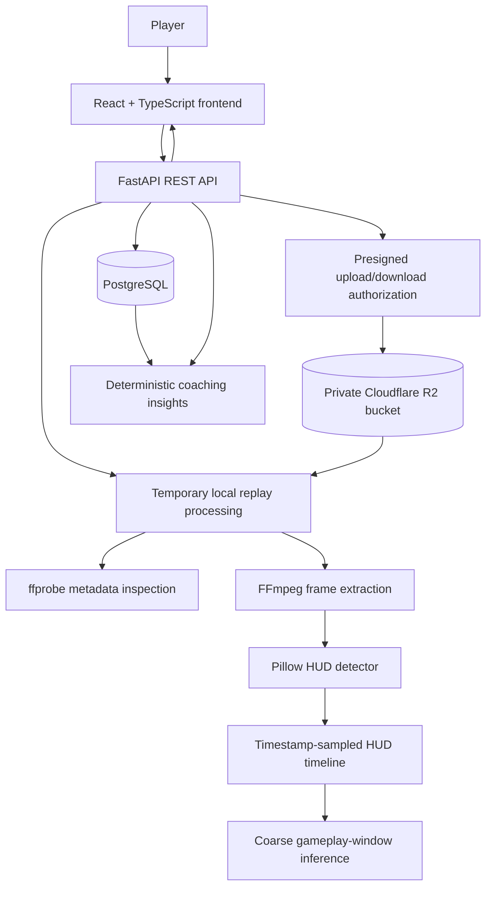

# Guilty Gear Coach

Guilty Gear Coach is a full-stack match tracking and deterministic replay-analysis project for **Guilty Gear Strive** players. It started as a way to help my brother review his matches more efficiently, and it has grown into an engineering project focused on extracting objective facts from uploaded gameplay footage.

The long-term direction is a deterministic **“Stockfish for Guilty Gear Strive”**:

```text
uploaded gameplay -> deterministic replay analysis -> objective gameplay facts -> deterministic coaching/insights
```

The project is not a finished Stockfish equivalent, replay parser, AI gameplay analyzer, OCR system, or machine-learning model. Today, it combines a useful manual match tracker with early replay-analysis primitives: private MP4 storage, video metadata inspection, frame extraction, deterministic HUD detection, timestamp-sampled HUD timelines, and coarse gameplay-window inference.

## Current Highlights

- Full-stack React/TypeScript + FastAPI application with PostgreSQL persistence.
- JWT authentication with user-owned matches, replays, and coaching data.
- Manual match tracking for characters, matchup, rank, score, notes, mistake tags, strengths, loss reasons, and practice focus.
- Deterministic coaching insights from match history, including trends, streaks, matchup summaries, repeated mistakes, and practice priorities.
- Private MP4 replay storage using Cloudflare R2 through S3-compatible presigned upload/download URLs.
- Backend upload verification, authorized download, and object cleanup when replay metadata or parent matches are deleted.
- `ffprobe` metadata inspection and FFmpeg frame extraction from private uploaded videos.
- Pillow-based deterministic GGST combat-HUD detection from extracted image pixels.
- Timestamp-sampled HUD timelines and coarse gameplay-window inference with uncertainty ranges.

## Demo / Screenshots

### Dashboard

Populated match tracking dashboard with win rate, opponent performance, mistake tags, and recent match history.



### Coaching Insights

Deterministic coaching recommendations generated from logged match history only.



### Replay Processing

Private uploaded replay video with inspected technical metadata, explicit timestamp input, and an extracted gameplay frame.



## What The App Does Today

### Match Tracking

- Register, log in, and manage account-scoped match history.
- Create, edit, delete, and review completed Guilty Gear Strive sets.
- Track player character, opponent character, result, rank, date, duration, score context, notes, mistakes, strengths, reason for loss, and next practice focus.
- View dashboard statistics such as win rate, recent matches, matchup performance, mistake frequency, and loss reasons.

### Deterministic Coaching

- Computes evidence-backed insights from manually entered match data only.
- Reports recent performance, win/loss streaks, most played character, strong and weak matchups, repeated mistakes, and recurring practice priorities.
- Produces structured recommendations with priorities, sample sizes, and supporting evidence.
- Avoids claiming strong conclusions when there is not enough match history.

### Replay Foundation

- Attach one or more replay records to a match.
- Store metadata-only replay sources or upload real MP4 gameplay videos.
- Upload MP4 bytes directly from the browser to private R2 object storage using a backend-issued presigned `PUT` URL.
- Confirm uploads by checking trusted object metadata through the backend before marking a replay uploaded.
- Generate short-lived authorized download URLs for uploaded videos.
- Delete R2 objects when an uploaded replay or its parent match is deleted.

### Replay Analysis Foundation

- Inspect uploaded MP4s with `ffprobe` for technical metadata such as duration, resolution, frame rate, and codec.
- Extract a single resized JPEG frame at an explicit timestamp using FFmpeg.
- Return sampled frames to the frontend for display without permanently storing frames.
- Classify extracted frames with deterministic Pillow-based HUD measurements:
  - `likely_gameplay_hud`
  - `not_gameplay_hud`
  - `unknown`
- Analyze multiple explicit timestamps from one replay while downloading the replay only once.
- Internally generate timestamp-sampled HUD timelines and infer coarse gameplay-window boundaries.

## Replay Analysis Pipeline

The current replay pipeline is intentionally deterministic and evidence-first:

```text
private replay object
  -> temporary local processing workspace
  -> ffprobe technical metadata inspection
  -> FFmpeg frame extraction
  -> Pillow-based HUD measurements
  -> HUD classification
  -> timestamp-sampled HUD timeline
  -> coarse gameplay-window inference
```

The HUD detector looks for standard Guilty Gear Strive combat HUD structure in sampled frames. It does not read the timer, identify characters, detect moves, inspect health values, or understand gameplay decisions yet.

Visual ambiguity and technical failures are kept separate:

- `unknown` means the frame was processed successfully but the visual evidence was ambiguous.
- A failed sample means extraction or detection failed technically.

The gameplay-window inference also avoids fake precision. For example, a manually verified replay produced coarse boundaries approximately like:

```text
start boundary: [12s, 14s]
end boundary:   [58s, 60s]
```

Those are uncertainty ranges from sampled evidence, not exact transition timestamps. Boundary refinement is planned next but is not implemented yet.

## Architecture



Replay ownership is enforced through:

```text
Replay -> Match -> User
```

The frontend never receives storage credentials, permanent public object URLs, or raw filesystem paths. FastAPI remains the authorization/control plane, while MP4 bytes go directly between the browser and private object storage.

## Tech Stack

### Backend

- Python 3.12
- FastAPI
- SQLAlchemy
- Alembic
- PostgreSQL
- Pydantic settings
- JWT authentication with `python-jose`
- Password hashing with `passlib` / bcrypt
- `boto3` for S3-compatible Cloudflare R2 access
- FFmpeg / `ffprobe`
- Pillow
- pytest

### Frontend

- React
- TypeScript
- Vite
- React Router
- Vitest
- Nginx for the Docker production-style frontend container

### Infrastructure

- Docker Compose
- PostgreSQL container
- FastAPI backend container
- Static frontend container
- Private Cloudflare R2 bucket through the S3-compatible API

## Key Engineering Features

- **Private replay storage lifecycle:** browser-to-R2 direct upload, backend confirmation, authorized download, and cleanup on destructive deletes.
- **Ownership enforcement:** every match, replay, upload, download, inspection, and deletion path is scoped through the authenticated user.
- **Deterministic video processing:** `ffprobe` extracts trusted technical metadata and FFmpeg extracts sampled frames without loading entire MP4s into Python memory.
- **Image-based HUD detection:** Pillow-based measurements classify whether a sampled frame contains the standard GGST combat HUD.
- **Timestamp-sampled analysis:** batch HUD detection and internal timeline scanning analyze repeated timestamps from one downloaded replay.
- **Uncertainty-aware segmentation:** gameplay windows are represented as coarse boundary ranges instead of pretending sampled observations prove exact frame-level transitions.
- **Testable architecture:** storage, frame extraction, HUD detection, timeline scanning, and gameplay-window inference are separated into focused backend services.

## API Overview

FastAPI serves interactive API documentation at:

```text
http://localhost:8000/docs
```

Important route groups:

### Authentication and Users

- `POST /api/auth/signup`
- `POST /api/auth/login`
- `GET /api/users/me`

### Matches and Stats

- `GET /api/matches`
- `POST /api/matches`
- `GET /api/matches/{match_id}`
- `PATCH /api/matches/{match_id}`
- `DELETE /api/matches/{match_id}`
- `GET /api/stats/dashboard`
- `GET /api/coaching/insights`

### Replay Metadata

- `GET /api/matches/{match_id}/replays`
- `POST /api/matches/{match_id}/replays`
- `GET /api/matches/{match_id}/replays/{replay_id}`
- `PATCH /api/matches/{match_id}/replays/{replay_id}`
- `DELETE /api/matches/{match_id}/replays/{replay_id}`

### Replay Storage

- `POST /api/matches/{match_id}/replays/uploads`
- `POST /api/matches/{match_id}/replays/{replay_id}/confirm-upload`
- `POST /api/matches/{match_id}/replays/{replay_id}/download-url`

### Replay Processing and HUD Detection

- `POST /api/matches/{match_id}/replays/{replay_id}/inspect`
- `POST /api/matches/{match_id}/replays/{replay_id}/frames/sample`
- `POST /api/matches/{match_id}/replays/{replay_id}/hud-detection`
- `POST /api/matches/{match_id}/replays/{replay_id}/hud-detections`

Internal services such as timestamp generation, HUD timeline scanning, and gameplay-window inference are backend primitives and are not currently exposed as public API routes.

## Project Structure

```text
guilty-gear-coach/
  backend/
    alembic/            Database migrations
    app/
      api/routes/       FastAPI route modules
      core/             Settings, database, auth, storage config
      models/           SQLAlchemy models
      schemas/          Pydantic request/response schemas
      services/         Coaching, storage, video, HUD, and timeline logic
    scripts/            Local calibration/development utilities
    tests/              pytest backend tests
  frontend/
    src/
      api/              Typed API client
      auth/             Authentication context
      components/       Shared UI and replay components
      pages/            Route pages
      test/             Frontend test setup
```

## Running Locally

### Docker

1. Copy the example environment file:

```bash
cp .env.example .env
```

2. Fill in secrets and storage settings as needed. The app can run basic match tracking without real R2 credentials, but MP4 upload/download/inspection requires valid private R2 configuration.

3. Start the stack:

```bash
docker compose up --build
```

4. Open:

```text
Frontend: http://localhost:8080
API docs: http://localhost:8000/docs
Health:   http://localhost:8000/health
```

The backend container runs `alembic upgrade head` on startup. The Docker setup uses production-style images, so source-code changes usually require rebuilding and recreating the affected container.

### Backend Development

```bash
cd backend
python -m venv .venv
source .venv/bin/activate
pip install -r requirements.txt
alembic upgrade head
uvicorn app.main:app --reload
```

Local replay metadata inspection and frame extraction require `ffprobe` and FFmpeg to be available on the backend `PATH`. The Docker backend image installs these tools.

### Frontend Development

```bash
cd frontend
npm install
npm run dev
```

Set `VITE_API_URL=http://localhost:8000/api` if the frontend dev server is not using the Docker/Nginx `/api` proxy.

## Cloudflare R2 Configuration

Real credentials should live only in `.env` or a deployment secret manager. Do not commit them.

Required storage variables:

```text
S3_ENDPOINT_URL=https://<account-id>.r2.cloudflarestorage.com
S3_BUCKET_NAME=guilty-gear-coach-replays
S3_REGION=auto
S3_ACCESS_KEY_ID=<r2-access-key-id>
S3_SECRET_ACCESS_KEY=<r2-secret-access-key>
S3_PRESIGNED_UPLOAD_EXPIRATION_SECONDS=900
S3_PRESIGNED_DOWNLOAD_EXPIRATION_SECONDS=300
MAX_MP4_UPLOAD_SIZE_BYTES=2147483648
```

Minimum R2 setup:

1. Create a private R2 bucket.
2. Create R2 API credentials with object read/write/head/delete access for that bucket.
3. Use the account-level S3-compatible endpoint.
4. Keep `S3_REGION=auto` for R2 unless your provider requires something else.
5. Configure bucket CORS for the frontend origins that will use presigned URLs.

Local CORS example:

```json
[
  {
    "AllowedOrigins": ["http://localhost:8080", "http://localhost:5173"],
    "AllowedMethods": ["PUT", "GET"],
    "AllowedHeaders": ["Content-Type"],
    "ExposeHeaders": ["ETag"],
    "MaxAgeSeconds": 3600
  }
]
```

For production, replace the localhost origins with the exact deployed frontend origin. Keep the bucket private; do not enable public replay access.

## Testing

Backend tests:

```bash
cd backend
pytest
```

Backend tests through the Docker backend container:

```bash
docker compose exec backend sh -lc "PYTHONPATH=/app pytest"
```

Frontend tests and production build:

```bash
cd frontend
npm test
npm run build
```

The automated tests cover authentication, account isolation, match CRUD and validation, dashboard/coaching calculations, replay metadata, private storage behavior with mocked S3/R2 calls, upload confirmation, deletion cleanup, video metadata inspection, frame extraction, HUD detection, HUD timeline scanning, gameplay-window inference, and frontend match/replay workflows.

Automated tests do not require real Cloudflare credentials, real R2 network access, or large replay fixtures.

## Current Development Status

### Implemented

- Full-stack authenticated match tracker.
- User-owned match, dashboard, coaching, and replay workflows.
- Private MP4 replay upload/download through Cloudflare R2 presigned URLs.
- Upload confirmation and R2 object cleanup.
- Technical video metadata inspection.
- Single-frame extraction and frontend display.
- Deterministic single-frame and multi-timestamp HUD detection.
- Internal timestamp-sampled HUD timeline scanning.
- Internal coarse gameplay-window inference with uncertainty ranges.

### In Development / Next

- Phase 4.5B-4: refine coarse gameplay boundary ranges by sampling more densely near transitions.

### Longer-Term Direction

- More robust gameplay segment discovery.
- Round and game boundary detection.
- HUD-region extraction for timer, health, Burst, and Tension signals.
- Deterministic gameplay events and analysis findings.
- Coaching recommendations grounded in extracted replay facts.
- Optional natural-language explanations after deterministic evidence exists.

## Product Vision

The long-term analysis hierarchy is expected to evolve toward:

```text
Replay
  -> Set / Match
  -> Game
  -> Round
  -> Gameplay Event
  -> Deterministic Analysis Finding
  -> Coaching Recommendation
  -> Optional LLM Explanation
```

Terminology:

- A round is one health-bar battle.
- A game is won by taking two rounds.
- A set contains multiple games.
- Standard online and tournament formats may use different numbers of games required to win a set.

Future replay analysis may eventually identify neutral losses, missed anti-airs, failed punish opportunities, unsafe attacks, Burst mistakes, Tension usage, defensive habits, repeated mistakes, wall-break decisions, game-level turning points, and round-level turning points.

The important design constraint is that replay facts should come from deterministic analysis. A future language model may explain findings in plain English, but it should not invent the underlying gameplay evidence.

## What This Project Is Not Yet

- Not a native Guilty Gear Strive replay parser.
- Not a complete video understanding system.
- Not OCR, machine learning, or computer vision model training.
- Not a deployed production service.
- Not a replacement for human match review yet.

The current implementation is the foundation for those later capabilities: secure replay ingestion, deterministic frame inspection, timestamp-sampled evidence, and coarse gameplay segmentation.
