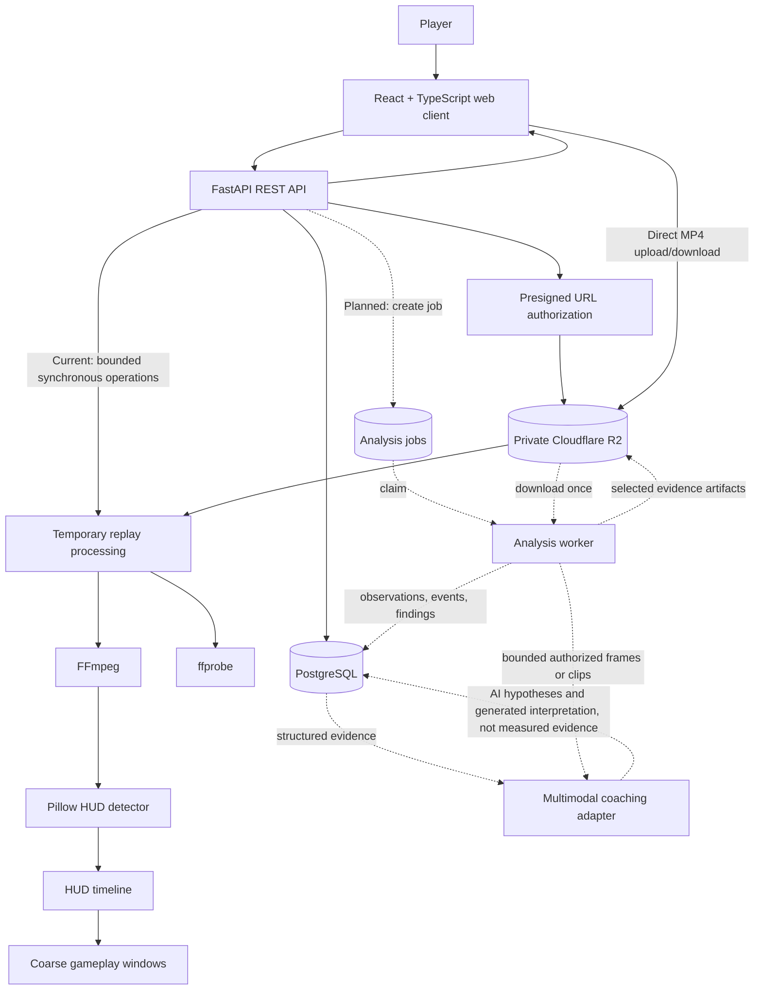

# Architecture

This document describes both the architecture that exists today and the approved direction for post-match replay analysis. Sections marked **Current** describe implemented behavior. Sections marked **Planned** describe intended boundaries or candidate technologies and must not be treated as installed features.

The immediate product target is analysis of uploaded replay footage after a match. Live or real-time coaching may be reconsidered later, but the current system should not take on streaming infrastructure or real-time latency requirements prematurely.

---

## Architectural Goal

Guilty Gear Coach is evolving from a manual match tracker into an evidence-grounded replay coach with complementary analysis paths:

```text
                    -> CV measurements -> events -> deterministic findings
uploaded replay ----|
                    -> multimodal interpretation -> AI coaching hypotheses

both paths -> evidence-linked review and practice recommendations
```

The intended result is "Stockfish-like" in the review experience, not in its internal mechanics. Stockfish receives exact chess state and can search legal moves. Guilty Gear Coach receives compressed video, so it cannot assume exact inputs, frame state, hitboxes, or available actions. Its job is to identify useful review moments, explain the supporting evidence, communicate uncertainty, and suggest practice priorities.

Deterministic computer vision, versioned gameplay rules, and multimodal LLM gameplay understanding are the three planned analysis tracks. The multimodal model directly examines authorized clips or sampled frames and may propose decision assessments, missed opportunities, alternatives, outcome explanations, and practice priorities. It is not restricted to rewriting deterministic findings. Its unvalidated output remains an AI coaching hypothesis rather than measured evidence. The multimodal track is optional and degradable for each run, while remaining a core product capability.

---

## Stack

### Current Stack

| Layer | Tool | Purpose |
| --- | --- | --- |
| Web client | React + TypeScript | Authenticated application UI |
| Build tool | Vite | Frontend development and production build |
| Client routing | React Router | Public and protected page routing |
| API | FastAPI | REST endpoints, authorization, and request/response mapping |
| Validation and settings | Pydantic + pydantic-settings | API contracts and environment configuration |
| ORM | SQLAlchemy | PostgreSQL models and queries |
| Migrations | Alembic | Versioned database schema changes |
| Relational database | PostgreSQL 16 | Users, matches, replay metadata, and future analysis records |
| Authentication | JWT with `python-jose`; passlib/bcrypt | Email/password authentication and bearer tokens |
| Object storage | Private Cloudflare R2 through `boto3` | Uploaded MP4 replay objects |
| Video inspection | `ffprobe` | Duration, dimensions, frame rate, and codec metadata |
| Frame extraction | FFmpeg | Timestamp-based replay frame extraction |
| Image analysis | Pillow | Current deterministic HUD-region measurements |
| Backend tests | pytest | Service, API, validation, and ownership tests |
| Frontend tests | Vitest | Frontend logic and component behavior tests |
| Local orchestration | Docker Compose | PostgreSQL, backend, and frontend containers |
| Frontend serving | Nginx | Serves the production frontend build and proxies API traffic |

### Planned or Conditional Technologies

These technologies should be introduced only when the related feature is approved and the existing tools are insufficient.

| Need | Candidate | Intended use | Adoption point |
| --- | --- | --- | --- |
| Long-running analysis | Dedicated Python worker with PostgreSQL-backed jobs | Process full replays outside HTTP requests | Next major replay-analysis stage |
| Richer deterministic vision | `opencv-python-headless` | Template matching, masks, contours, motion, tracking, and preprocessing | When Pillow measurements cannot support the next detector |
| Job progress | HTTP polling first; Server-Sent Events if justified | Report queued, running, completed, and failed states | With persisted analysis jobs |
| Multimodal gameplay understanding | One backend-only provider adapter behind an application-owned structured contract | Inspect bounded frames or clips and propose clearly labelled gameplay and coaching hypotheses | Prototype after Stage 3 privacy, persistence, and derived-media gates; may overlap segmentation work |
| Dataset annotation | CVAT | Label video intervals, HUD signals, characters, and gameplay events | Before training custom models |
| Model training | PyTorch | Train focused classifiers or detectors from labelled data | Only after deterministic methods and labelled data prove insufficient |
| Model inference | ONNX Runtime | Run validated exported models on CPU or GPU | After a trained model is ready for deployment |
| Constrained text or digit reading | Template matching first; OCR library selected by experiment | Read stable HUD elements such as timer digits when needed | After round/game segmentation is reliable |
| Semantic retrieval | PostgreSQL full-text search first; `pgvector` if demonstrated | Retrieve relevant matchup or coaching knowledge | Only when relational lookup and text search are inadequate |
| Higher-throughput queue | Celery with Redis/RabbitMQ or a managed queue | Multi-worker scheduling and retry coordination | Only after PostgreSQL job claiming becomes a measured bottleneck |

No LLM provider, OCR engine, queue framework, model architecture, or GPU platform is selected yet. The multimodal capability is approved roadmap scope, but provider selection still belongs to its focused implementation plan and must consider current official documentation, privacy and retention terms, structured-output support, latency, cost, and measured evaluation results.

---

## System Overview



The FastAPI application remains the authorization and control plane. Large MP4 bytes travel directly between the browser and private object storage for upload and authorized download. Processing services may temporarily download an owned replay, but temporary artifacts must be cleaned up.

---

## Folder Structure

```text
guilty-gear-coach/
|-- AGENTS.md                         Project-wide agent and engineering rules
|-- context/                          Project context and architectural decisions
|   |-- project-overview.md           Product scope and vocabulary
|   |-- architecture.md               System boundaries and planned data flow
|   |-- ui-tokens.md                  Visual token contract
|   |-- ui-rules.md                   UI behavior and accessibility rules
|   |-- ui-registry.md                Registered reusable UI patterns
|   |-- code-standards.md             Implementation standards
|   |-- library-docs.md               Dependency-specific guidance
|   |-- build-plan.md                 Roadmap scope and acceptance criteria
|   `-- progress-tracker.md            Current roadmap and verification status
|-- backend/
|   |-- alembic/                      Migration environment and versioned migrations
|   |-- app/
|   |   |-- api/
|   |   |   |-- deps.py              Shared FastAPI dependencies
|   |   |   `-- routes/              HTTP routes and authorization entry points
|   |   |-- core/                     Configuration, database sessions, and security
|   |   |-- models/                   SQLAlchemy persistence models
|   |   |-- schemas/                  Pydantic API contracts
|   |   |-- services/                 Business, storage, video, and analysis logic
|   |   `-- main.py                   FastAPI application composition
|   |-- scripts/                      Development and calibration utilities
|   `-- tests/                        pytest test suite
|-- frontend/
|   |-- src/
|   |   |-- api/                      Typed HTTP client and error normalization
|   |   |-- auth/                     Authentication state
|   |   |-- components/               Reusable UI components
|   |   |-- constants/                Shared frontend constants
|   |   |-- pages/                    Route-level screens
|   |   |-- utils/                    Focused frontend utilities
|   |   |-- types.ts                  Shared frontend domain types
|   |   `-- styles.css                Project styles
|   |-- Dockerfile
|   `-- nginx.conf
|-- docker-compose.yml
`-- README.md
```

When background analysis is introduced, worker entry points should receive their own focused location under `backend/app/`. Analysis stages should remain services and should only be split into subpackages after the number of modules makes the current flat service folder difficult to navigate.

---

## System Boundaries

| Location | Owns | Must not own |
| --- | --- | --- |
| `frontend/src/pages/` | Route-level composition, page state, and user workflows | Database queries, storage credentials, or backend policy |
| `frontend/src/components/` | Reusable presentation and interactions | Direct database or R2 access |
| `frontend/src/api/` | HTTP transport, bearer-token attachment, and error normalization | Domain calculations or UI rendering |
| `frontend/src/auth/` | Current-user state and session restoration | Backend authorization decisions |
| `backend/app/api/routes/` | HTTP concerns, dependencies, ownership checks, status codes, and response mapping | Reusable analysis algorithms or cross-route helper imports |
| `backend/app/schemas/` | Validated API request and response contracts | Persistence behavior |
| `backend/app/models/` | SQLAlchemy tables and relationships | HTTP behavior or analysis orchestration |
| `backend/app/services/` | Reusable domain logic, R2 operations, subprocess adapters, and analysis stages | Request-specific response construction |
| `backend/app/core/` | Settings, database sessions, authentication primitives, and application infrastructure | Feature-specific analysis logic |
| `backend/alembic/` | Forward schema history | Runtime business logic |
| `backend/scripts/` | Explicit development and calibration tools | Production request handling |
| `backend/tests/` | Regression, domain, ownership, and adapter-boundary tests | Real user data or production infrastructure mutations |
| PostgreSQL | Structured application state, analysis provenance, and compact evidence | MP4 files or large frame collections |
| Private R2 | Original replay videos and selected derived binary artifacts | Authorization policy or queryable analysis state |

### Planned Logical Boundaries

The future replay system should preserve these logical responsibilities even if they initially remain in the same Python application:

| Boundary | Responsibility |
| --- | --- |
| Job coordinator | Create, claim, retry, cancel, and report analysis runs |
| Evidence extraction | Produce measurements from video without making coaching claims |
| Event inference | Convert related observations into timestamped gameplay events |
| Domain evaluator | Apply versioned Guilty Gear rules and knowledge to produce findings |
| Recommendation builder | Turn findings and match history into practice priorities |
| Multimodal adapter | Submit authorized bounded media and structured context, then validate generated gameplay interpretations and coaching hypotheses |
| Evaluation tooling | Compare analyzer output with manually labelled replay truth |

These are boundaries of responsibility, not a requirement for separate deployable services.

---

## Data Flow

### Authentication

```text
Signup or login form
  -> FastAPI validates credentials
  -> backend issues JWT access token
  -> frontend stores token locally
  -> API client sends Bearer token
  -> get_current_user resolves authenticated user
  -> protected query is scoped to that user
```

The frontend's protected-route check is a user-experience feature. Backend ownership checks remain authoritative.

### Match Creation and Coaching

```text
Match form
  -> frontend validation and normalization
  -> POST /api/matches
  -> Pydantic authoritative validation
  -> authenticated owner assigned by backend
  -> PostgreSQL match row
  -> dashboard and coaching services derive summaries
```

Current coaching uses only stored match history and explicit user-entered notes or tags.

### Replay Upload

```text
User selects MP4
  -> FastAPI verifies match ownership
  -> pending replay row + user-scoped storage key
  -> short-lived presigned PUT URL
  -> browser uploads MP4 directly to private R2
  -> frontend asks FastAPI to confirm
  -> backend reads trusted object metadata
  -> replay marked uploaded
```

PostgreSQL and R2 are separate resources. A database write cannot atomically commit an R2 operation, so upload, confirmation, replacement, and deletion flows must handle partial failure explicitly.

### Current Replay Inspection and Sampling

```text
Authorized replay request
  -> validate ownership, upload state, and timestamp
  -> download replay to a temporary workspace
  -> ffprobe inspection or FFmpeg frame extraction
  -> optional Pillow HUD detection
  -> return metadata, image bytes, or detection result
  -> delete temporary files
```

The existing route operations are acceptable for bounded inspection and explicit frame requests. Full-replay processing must move to a worker rather than keeping an HTTP request open.

### Planned Full Replay Analysis

```text
User requests analysis
  -> FastAPI verifies Replay -> Match -> User ownership
  -> create versioned analysis run in queued state
  -> worker claims the run
  -> download replay once to a temporary workspace
  -> inspect and normalize video metadata
  -> deterministic path: segments -> observations -> events -> findings
  -> multimodal path when gates pass: bounded media -> AI coaching hypotheses
  -> store each output with its own provenance and validation state
  -> mark run completed or failed
  -> clean temporary workspace
```

Each stage should be idempotent or replace its own output for a specific analysis-run version. Re-running a newer analyzer must create a distinguishable run rather than silently changing the historical meaning of old results.

### Planned Multimodal Coaching

```text
Bounded authorized frames or clips + available deterministic evidence and context
  -> build bounded structured coaching context
  -> call provider through backend-only adapter
  -> require structured response with evidence identifiers
  -> validate response
  -> reject or flag references to unavailable evidence
  -> persist model, prompt version, inputs, output, and caveats
  -> display AI hypotheses and explanations separately from measured facts
```

A multimodal model may describe supplied media, assess possible good or bad decisions, identify candidate missed opportunities or punishes, propose alternatives, explain possible outcomes, and suggest practice. It may contribute a hypothesis that no deterministic rule produced. It must not create or overwrite measured observations, and an unvalidated interpretation must not be presented as a verified fact. Direct inspection of a short clip does not turn model output into deterministic evidence, even when the description appears accurate.

Before private user media can leave project-controlled infrastructure, the product must decide and communicate consent, provider retention and training terms, deletion expectations, maximum media size, latency and cost limits, and whether the feature is enabled for ordinary users. Provider or consent failure skips only the generated layer; it does not fail completed deterministic analysis.

---

## Evidence Model

The deterministic evidence path uses four levels:

1. **Observation** - a direct measurement from video, such as a HUD classification, estimated health percentage, or visible Burst indicator.
2. **Gameplay event** - a time-bounded change inferred from observations, such as damage, resource expenditure, round end, or entering the corner.
3. **Analysis finding** - a domain interpretation supported by events or observations, such as a possible unused-resource review point.
4. **Coaching recommendation** - a practice priority derived from findings and match history.

Alongside that path, a **multimodal gameplay interpretation** is generated analysis of authorized media and structured context. It may contain an **AI coaching hypothesis** about decisions, opportunities, alternatives, outcomes, or practice. Generated interpretations can reinforce, question, or extend the deterministic path, but they do not become a fifth level of measured evidence.

Every stored result should retain enough provenance to answer:

- Which replay and analysis run produced it?
- Which timestamp or uncertainty range supports it?
- Which analyzer, configuration, game patch, rule, model, or prompt version produced it?
- Was the result measured, inferred, manually entered, or language-model generated?
- What confidence or ambiguity was reported?
- Can a developer or user open the supporting replay moment?

### Result Status Semantics

- `ok`: processing succeeded and produced a result.
- `unknown`: processing succeeded, but the evidence was inconclusive.
- `failed`: the technical operation failed.

Unknown evidence must not be collapsed into failure, absence, or a negative finding. A model confidence score also does not convert an inference into an objective fact.

---

## PostgreSQL Schema

### Current Tables

#### `users`

| Column | Type | Notes |
| --- | --- | --- |
| `id` | integer | Primary key |
| `email` | varchar(320) | Unique, indexed |
| `username` | varchar(80) | Unique, indexed |
| `password_hash` | varchar(255) | Bcrypt password hash |
| `created_at` | timestamptz | Server-created timestamp |

#### `matches`

| Column | Type | Notes |
| --- | --- | --- |
| `id` | integer | Primary key |
| `owner_id` | integer | References `users.id`; indexed; cascade delete |
| `player_character` | varchar(80) | Indexed |
| `opponent_character` | varchar(80) | Indexed |
| `result` | varchar(8) | Indexed win/loss value |
| `played_on` | date | Indexed |
| `rank_floor` | varchar(80), nullable | Rank or floor context |
| `duration_seconds` | integer, nullable | Manually recorded duration |
| `rounds_won` | integer, nullable | Completed-set score |
| `rounds_lost` | integer, nullable | Completed-set score |
| `first_to` | integer, nullable | Set format |
| `notes` | text, nullable | User review notes |
| `mistake_tags` | text array | User-entered mistake categories |
| `strength_tags` | text array | User-entered strengths |
| `reason_for_loss` | varchar(160), nullable | User-entered summary |
| `practice_next` | text, nullable | User-entered practice priority |
| `replay_filename` | varchar(255), nullable | Legacy field retained after replay-table migration |
| `created_at` | timestamptz | Server-created timestamp |
| `updated_at` | timestamptz | Last update timestamp |

#### `replays`

| Column | Type | Notes |
| --- | --- | --- |
| `id` | integer | Primary key |
| `match_id` | integer | References `matches.id`; indexed; cascade delete |
| `source_type` | varchar(32) | `replay_file`, `video`, or `external_reference` |
| `original_filename` | varchar(255), nullable | User-facing source name |
| `storage_key` | varchar(1024), nullable | Unique private R2 object key |
| `upload_status` | varchar(32) | `metadata_only`, `pending_upload`, or `uploaded` |
| `content_type` | varchar(255), nullable | Trusted storage metadata after confirmation |
| `size_bytes` | bigint, nullable | Non-negative trusted storage size |
| `uploaded_at` | timestamptz, nullable | Confirmed upload time |
| `processing_status` | varchar(32) | `not_processed`, `processing`, `processed`, or `failed` |
| `processing_error` | varchar(255), nullable | Safe public failure message |
| `metadata_inspected_at` | timestamptz, nullable | Last successful technical inspection |
| `video_duration_seconds` | float, nullable | Non-negative duration |
| `video_width` | integer, nullable | Positive width |
| `video_height` | integer, nullable | Positive height |
| `video_fps` | float, nullable | Positive frame rate |
| `video_codec` | varchar(80), nullable | Reported video codec |
| `created_at` | timestamptz | Server-created timestamp |
| `updated_at` | timestamptz | Last update timestamp |

Ownership follows:

```text
Replay -> Match -> User
```

All replay queries and actions must enforce that chain on the backend.

### Planned Analysis Persistence

The following are conceptual entities, not current tables. They should be added incrementally through Alembic migrations when a feature needs them; do not create the entire future schema in advance.

| Entity | Minimum responsibility |
| --- | --- |
| `analysis_runs` | Replay, job state, pipeline/configuration version, timestamps, progress, and safe failure details |
| `analysis_segments` | Gameplay, game, or round boundary ranges with kind, confidence, and supporting evidence |
| `analysis_observations` | Timestamped measured values, status, confidence, analyzer version, and compact evidence |
| `gameplay_events` | Time-bounded inferred changes with actor, event type, confidence, and observation references |
| `analysis_findings` | Versioned domain rule results with severity, explanation data, and event/observation references |
| `coaching_recommendations` | Prioritized practice actions derived from findings and match history |
| `multimodal_interpretations` | Provider/model identifier, prompt version, supplied media/evidence IDs, validated hypotheses and explanations, caveats, and independent-validation state |
| `analysis_feedback` | User confirmation, rejection, correction, or usefulness rating for findings and generated interpretations |

Large images, video clips, model files, and full frame sequences do not belong in PostgreSQL. Store only compact measurements, structured results, provenance, and private object references.

---

## Cloudflare R2 Storage

### Current Replay Objects

```text
users/{user_id}/matches/{match_id}/replays/{random_id}.mp4
```

- The bucket is private.
- The backend holds storage credentials.
- The browser receives only short-lived presigned URLs.
- Upload confirmation uses storage metadata rather than client claims.
- Authorized deletion removes the R2 object and the related database record with explicit partial-failure handling.

### Planned Derived Artifacts

Only persist a derived artifact when it is required for product behavior, debugging, or reproducible evidence. Possible future paths include:

```text
users/{user_id}/replays/{replay_id}/analysis/{run_id}/clips/{artifact_id}.mp4
users/{user_id}/replays/{replay_id}/analysis/{run_id}/images/{artifact_id}.jpg
models/{analyzer_name}/{model_version}/model.onnx
```

Derived user evidence must remain private and follow the replay's ownership. Model artifacts are application assets and require an independent trust and versioning policy.

---

## Authentication and Authorization

- Authentication is currently email/password with JWT bearer tokens.
- Public routes are `/`, `/login`, and `/signup`.
- Application routes under dashboard, coaching, and matches require an authenticated user in the frontend.
- Every protected backend route resolves the current user independently.
- Match ownership is enforced with `matches.owner_id`.
- Replay ownership is inherited through its parent match.
- Client-supplied owner identifiers are never trusted.
- Inaccessible resources should preserve the established not-found behavior rather than revealing another user's data.
- Storage credentials, LLM keys, administrative operations, and permanent object URLs must never enter browser code.

If the authentication strategy later changes, ownership relationships in PostgreSQL remain the source of authorization policy.

---

## Replay Analysis Pipeline

### Current Pipeline

```text
private replay object
  -> temporary local MP4
  -> ffprobe metadata inspection
  -> FFmpeg frame extraction
  -> Pillow HUD measurements
  -> HUD classification
  -> timestamp-sampled HUD timeline
  -> coarse gameplay-window inference
```

Current classifications are:

- `likely_gameplay_hud`
- `not_gameplay_hud`
- `unknown`

The current pipeline does not identify characters, read timer values, measure health, recognize moves, infer player inputs, detect tactical decisions, or produce replay-derived coaching.

### Target Deterministic Pipeline Stages

1. **Validate input** - ownership, upload readiness, file metadata, duration, dimensions, and resource limits.
2. **Normalize technical metadata** - establish the source frame rate, resolution, and analysis configuration.
3. **Discover gameplay segments** - identify coarse combat windows and refine uncertain transitions.
4. **Identify games and rounds** - produce ranges rather than false exact boundaries when evidence is sampled.
5. **Extract HUD signals** - timer, health, Burst, Tension, round markers, and character identity as independently testable signals.
6. **Extract spatial or action signals** - player position, corner state, movement, animation, hits, blocks, or resource changes as capabilities mature.
7. **Infer gameplay events** - combine observations over time into domain events.
8. **Evaluate events** - apply versioned GGST rules, patch-specific knowledge, and thresholds.
9. **Build recommendations** - aggregate repeated findings across rounds, games, sets, and match history.

Each stage must accept and return structured data so it can be unit tested, calibrated, replaced, and re-run independently.

### Parallel Multimodal Interpretation Stage

After Stage 3 provides authorized bounded media, persistent run identity, privacy controls, and evidence references, the multimodal path may inspect clips or sampled frames without waiting for every deterministic stage to exist. It returns source-linked decision analysis, coaching hypotheses, alternatives, explanations, and drills through a separately evaluated generated-output contract. Later CV observations and deterministic findings may enrich its context, but the LLM is not limited to restating them.

### First Useful Vertical Slice

The first replay-derived coaching slice is deliberately narrower than the eventual observation catalog:

```text
persisted analysis run
  -> supported round ranges
  -> deterministic Burst availability observation near round end
  -> evidence-linked Burst review moment
  -> optional per-run multimodal interpretation or coaching hypothesis
  -> separate correctness and usefulness feedback
```

The targeted wording is: "The round appears to have ended while Burst was visually available." This is a review moment, not automatically a mistake. The player may have had a valid tactical reason not to Burst, and visual or contextual evidence may be incomplete. Supporting media, detector status, uncertainty, and generated interpretation must remain distinguishable.

---

## Background Job Pattern

Full replay analysis is CPU-intensive and may take longer than an HTTP request. The planned first implementation is:

```text
FastAPI creates queued analysis run
  -> independent Python worker claims row transactionally
  -> worker opens its own database session
  -> worker records stage progress and heartbeat
  -> worker writes versioned outputs
  -> worker marks completed or failed
```

Initial job coordination should use PostgreSQL because the project already depends on it and expected concurrency is low. A separate broker and queue framework should be added only when retry behavior, throughput, priority scheduling, or multiple worker hosts justify the operational cost.

Required behavior:

- A worker receives identifiers, not request-scoped ORM objects or database sessions.
- Job claiming prevents two workers from processing the same run concurrently.
- Retries are bounded and distinguish transient infrastructure errors from invalid replay input.
- Stale running jobs can be detected and recovered safely.
- A retry does not duplicate persisted findings for the same run and stage.
- Progress is durable; losing the API or worker process does not falsely report completion.
- Temporary files are deleted on success and failure.

---

## Multimodal LLM Gameplay-Understanding Pattern

The LLM is a core gameplay-interpretation and coaching capability, but not the source of measured replay facts. It may generate useful hypotheses directly from video even when deterministic analysis cannot verify the complete situation.

### Allowed Inputs

- User-entered match notes and practice goals.
- Current deterministic coaching summaries.
- Replay observations, events, findings, and confidence.
- Timestamped evidence identifiers, sampled frames, or short authorized clips.
- Curated, versioned GGST rules or matchup knowledge.

### Required Outputs

- Description of what appears to happen in the supplied media.
- Possible good or bad decisions.
- Candidate missed opportunities or punishes.
- Possible alternative actions.
- Explanation of why a decision may have worked or failed.
- Prioritized practice items, drills, or questions for manual review.
- Rationale tied to supplied media or evidence identifiers.
- Confidence, uncertainty, missing context, and relevant caveats.

### Guardrails

- LLM requests originate from the backend or worker; provider credentials never reach the browser.
- Every media artifact and evidence identifier is authorized through `Replay -> Match -> User` before inclusion.
- Requests use only the bounded frames or clips needed for the approved task, and temporary artifacts are cleaned up.
- Inputs and outputs use validated schemas rather than an unstructured text contract.
- The response cannot cite evidence identifiers that were not supplied.
- Generated interpretation is labelled separately from observations and deterministic findings, including when no deterministic rule independently supports the hypothesis.
- Provider, model, prompt version, input evidence, and output are recorded for reproducibility and debugging.
- Requests enforce configured time, media-size, frame-count, latency, and cost limits.
- Provider errors do not invalidate completed deterministic analysis.
- LLM output may be useful while imperfect; the UI must allow the user to assess or correct it.
- Sending private replay clips to a third-party model requires an explicit product decision, clear disclosure, and an appropriate retention policy.

An LLM feature limited to manual match history would not satisfy the Stage 5 gameplay-understanding milestone. If built separately, it must still use the same generated-provenance and labelling rules.

---

## Versioned Domain Knowledge

GGST patches can change characters, moves, damage, frame data, and system mechanics. Future domain data must therefore include:

- Game and patch version.
- Character and move identifiers.
- Source and license information.
- Import or review timestamp.
- Validation status.
- Rule or data version used by each finding.

Do not scrape or embed third-party frame data without confirming its terms and reliability. Relational lookup is preferred initially. Semantic retrieval is an optional enhancement, not a prerequisite for useful coaching.

---

## Testing and Evaluation

### Application Tests

- Backend route tests protect authentication, ownership, validation, and failure mapping.
- Pure services are tested without network or object-storage access where practical.
- R2, FFmpeg, `ffprobe`, LLM providers, and future model runtimes are mocked at their adapter boundaries in ordinary tests.
- Database-mutating tests require a verified disposable database.
- Frontend tests cover loading, empty, success, error, navigation, and important interaction states.

### Replay Analysis Evaluation

Replay analysis requires a versioned golden dataset in addition to unit tests:

- Small, legally usable replay clips across supported resolutions and compression levels.
- Manually reviewed game, round, and event timestamps.
- Expected HUD signals and explicit ambiguous cases.
- Coverage across characters, stages, sides, visual effects, and relevant game patches.
- Expected tolerance windows rather than exact timestamps where source evidence is coarse.

Detector changes should report suitable metrics, such as precision, recall, timestamp error, unknown rate, and technical failure rate. Thresholds must not be changed only to satisfy one fixture.

Multimodal quality should be evaluated separately for correspondence to source media, decision plausibility, alternative validity, uncertainty communication, unsupported verified-fact claims, usefulness, and knowledgeable human review. A fluent answer is not proof that a hypothesis is correct.

---

## Reliability and Failure Handling

- Validate ownership, upload state, and timestamps before downloading a replay when possible.
- Preserve FFmpeg and `ffprobe` timeouts and safe public errors.
- Apply file-size, duration, sample-count, and concurrency limits before expensive work.
- Use one temporary workspace per processing operation or analysis run.
- Do not expose local paths, subprocess output, secrets, or private object URLs in client errors.
- Preserve completed stage outputs when a later independent stage fails, while marking the overall run accurately.
- Keep PostgreSQL records and R2 objects recoverable when one half of a cross-resource operation fails.
- Cache or reuse an analysis output only when replay identity, analyzer version, configuration, and relevant game-data version match.

---

## Future Live Analysis

Live or real-time coaching is not a current requirement. The future path is kept open by making observations, events, findings, and recommendations independent of whether their source is an uploaded file or a stream.

If live analysis is approved later, it will require separate decisions about:

- Capture source and permissions.
- Streaming transport and latency budget.
- Incremental state handling.
- Local versus server inference.
- Cost and GPU requirements.
- Tournament rules, platform terms, fair-play expectations, and anti-cheat concerns.
- Whether feedback is allowed during play or only immediately afterward.

Do not add WebRTC, streaming brokers, low-latency GPU infrastructure, or live overlays to the post-match system in anticipation of that future.

---

## Architectural Invariants

Rules future implementation must preserve:

- FastAPI is the authorization and control plane.
- Every user-owned query is scoped through the authenticated user.
- Replay ownership always follows `Replay -> Match -> User`.
- The R2 bucket remains private; the browser never receives storage credentials.
- Large MP4 uploads use direct browser-to-storage transfer when the presigned flow supports it.
- Route modules own HTTP concerns; reusable processing belongs in services.
- Route modules do not import implementation helpers from other route modules.
- Background workers open their own resources and receive stable identifiers, not request-scoped objects.
- PostgreSQL stores structured state and provenance; R2 stores large binary artifacts.
- Technical failure, visual ambiguity, absence, and negative evidence remain distinct states.
- Sampled evidence retains uncertainty ranges; it does not claim unsupported frame precision.
- Observations, events, findings, review moments, recommendations, and multimodal interpretations—including AI coaching hypotheses and explanations—remain separate concepts.
- Multimodal model output is never stored or displayed as measured gameplay evidence.
- Analyzer, rule, game-data, model, and prompt versions are retained with their outputs.
- Full analysis is resumable, bounded, and safe to retry.
- Temporary replay artifacts are cleaned up.
- New dependencies are introduced only for an approved need and after checking installed versions and official documentation.
- New schema changes use forward Alembic migrations; applied migrations are not rewritten.
- A future live-analysis mode reuses evidence contracts where practical but does not distort the post-match architecture today.
